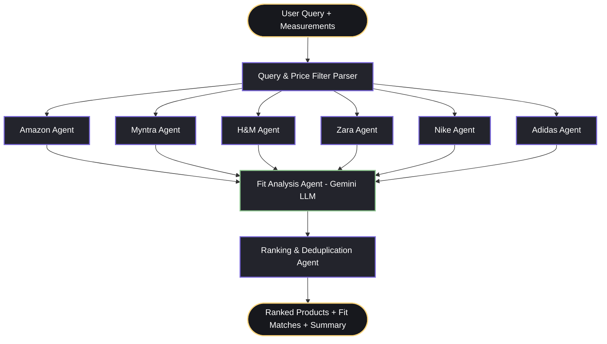

# FitFinder — LangGraph Multi-Agent Architecture 🤖👗

An AI-powered fashion sizing and discovery platform built with **LangGraph**, **LangChain**, **Google Gemini**, **FastAPI**, and **React 18 + TypeScript**.

Unlike static search, FitFinder runs a **distributed multi-agent graph** that distributes queries across brand agents simultaneously, analyses garment specs against the user's exact body measurements, and ranks products by personalized fit match.

---

## 🏗️ Architecture & Agent Graph

FitFinder uses a **LangGraph `StateGraph`** with parallel fan-out and sequential convergence:



### 🧠 The Agents

| Agent | Technology | Role |
|---|---|---|
| **Retailer Agents** (6 nodes) | Python / LangGraph parallel fan-out | Amazon, Myntra, H&M, Zara, Nike, and Adidas agents query their catalogues concurrently in parallel threads. |
| **Fit Analysis Agent** | Google Gemini 1.5 (`ChatGoogleGenerativeAI`) | Evaluates garment dimensions against user's chest, waist, shoulders, inseam, foot length, and fit preference (Slim/Regular/Relaxed/Oversized) to generate real-time fit scores (0-100%) and tailored explanations. |
| **Ranking Agent** | LangGraph Node | Deduplicates matching products, sorts by fit score descending, and creates a natural-language search summary. |

---

## 📁 Directory Structure

```
fitfinder-langgraph/
├── backend/
│   ├── agents/
│   │   ├── state.py         # SearchState TypedDict with operator.add merging
│   │   ├── nodes.py         # 6 retailer nodes + Gemini fit node + ranking node
│   │   ├── graph.py         # StateGraph compilation & edge routing
│   │   ├── parser.py        # Natural-language query & price range parser
│   │   └── data.py          # Multi-retailer product catalogue
│   ├── main.py              # FastAPI server (REST + SSE streaming)
│   ├── requirements.txt     # Python dependencies
│   ├── .env.example         # Environment template (GOOGLE_API_KEY)
│   └── .env                 # Local environment file
└── frontend/
    ├── src/
    │   ├── api/client.ts    # REST & Server-Sent Events (SSE) streaming client
    │   ├── components/
    │   │   ├── AgentSearchPanel.tsx # Live agent progress stream & filter chips
    │   │   ├── DiscoverPage.tsx     # Personalized recommendation feed
    │   │   ├── FitProfile.tsx       # Measurement editor (cm/in conversion)
    │   │   └── ProductDetails.tsx   # Detailed garment breakdown & direct store links
    │   ├── App.tsx          # 3-panel responsive dashboard layout
    │   └── main.tsx
    ├── package.json
    ├── tailwind.config.js   # FitFinder charcoal & pastel color theme
    └── vite.config.ts
```

---

## ⚡ Quick Start

### 1. Prerequisites
- **Python 3.10+** (Python 3.13 tested)
- **Node.js 18+** & **npm**

### 2. Backend Setup
```bash
cd fitfinder-langgraph/backend

# Install Python requirements
pip install -r requirements.txt

# (Optional) Add your Gemini API key for live LLM sizing analysis:
# Edit .env and set:
# GOOGLE_API_KEY=your_actual_key_here
# If omitted, the Fit Agent gracefully falls back to deterministic rule scoring!

# Start FastAPI server
python main.py
```
The backend will run on **`http://localhost:8000`** with interactive Swagger docs at **`http://localhost:8000/docs`**.

### 3. Frontend Setup
```bash
cd fitfinder-langgraph/frontend

# Install dependencies
npm install

# Start Vite dev server
npm run dev -- --port 5174
```
The frontend will run on **`http://localhost:5174`**.

---

## 📡 API Endpoints

- `GET /api/health` — Checks status and whether Gemini API key is configured.
- `GET /api/products` — Returns all demo fashion inventory across 6 brands.
- `POST /api/search` — Runs the full LangGraph pipeline synchronously:
  ```json
  {
    "query": "running shoes under 15000",
    "measurements": {
      "height": 175,
      "chest": 96,
      "waist": 82,
      "hips": 100,
      "shoulders": 44,
      "foot_length": 27,
      "unit": "cm"
    },
    "fit_preference": "relaxed"
  }
  ```
- `GET /api/search/stream` — **Server-Sent Events (SSE)** endpoint. Streams `agent_start`, `agent_done`, and `result` events in real-time as each LangGraph node processes.

---

## 💡 Key Highlights

1. **StateGraph Fan-Out/Fan-In**: Retailer search operations execute simultaneously in the graph, reducing search latency.
2. **Real-time SSE Streaming**: The UI visually updates live as each agent completes its tasks.
3. **Graceful Fallback**: Works out-of-the-box without an API key in Demo Mode, and automatically upgrades to live Gemini LLM sizing analysis when `GOOGLE_API_KEY` is supplied.
4. **Natural Language Price & Fit Parsing**: Handles queries like *"black jeans under ₹2,000"*, *"jackets between 3000 and 8000"*, or *"shoes for wide feet"*.
